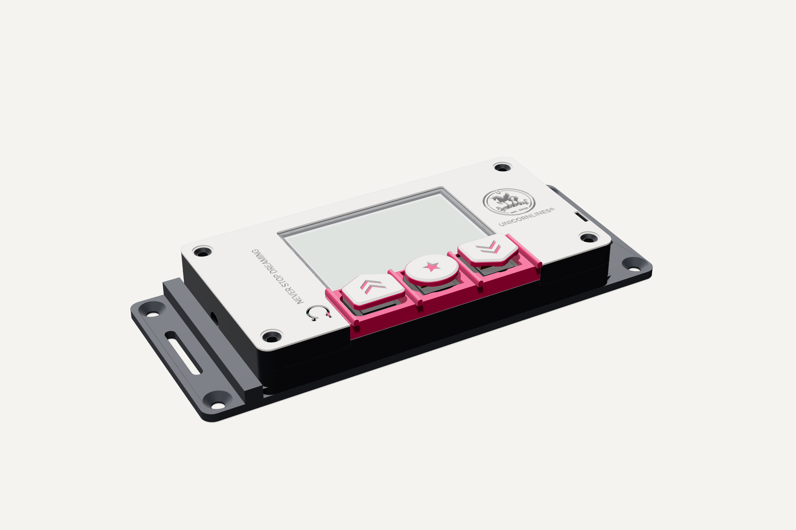
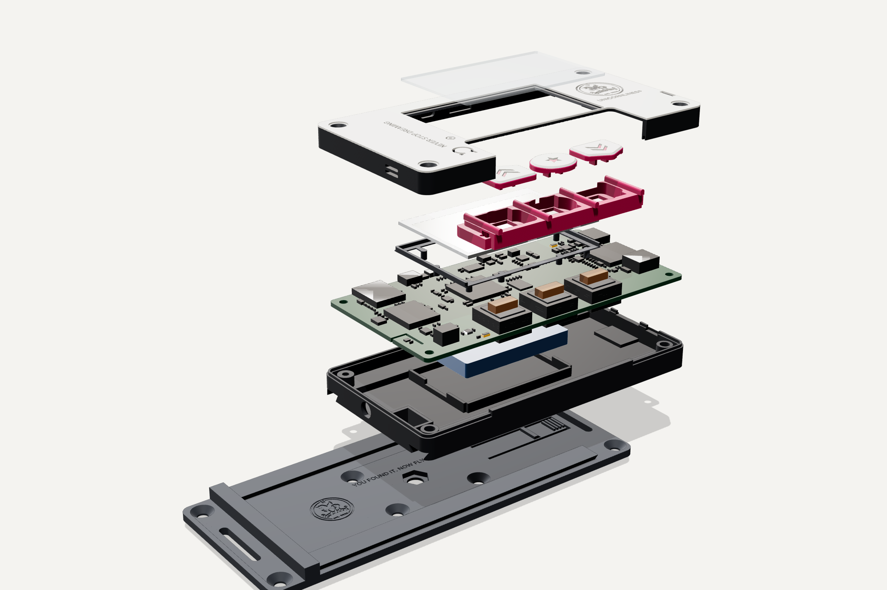
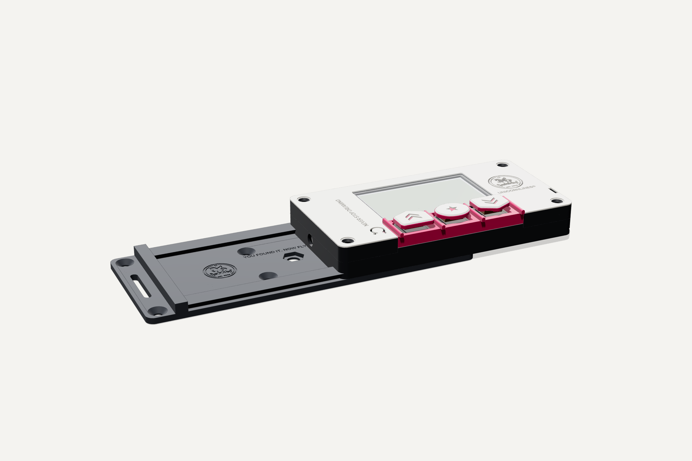
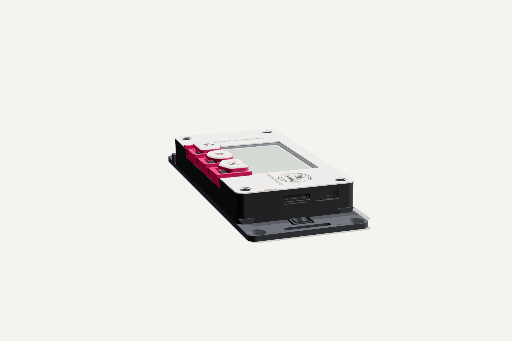
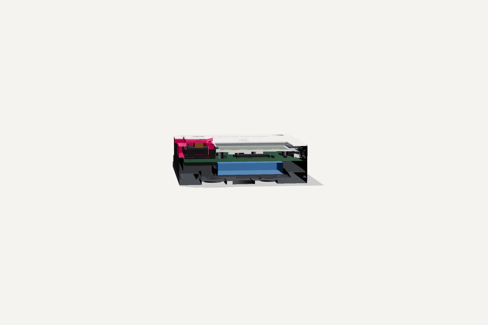
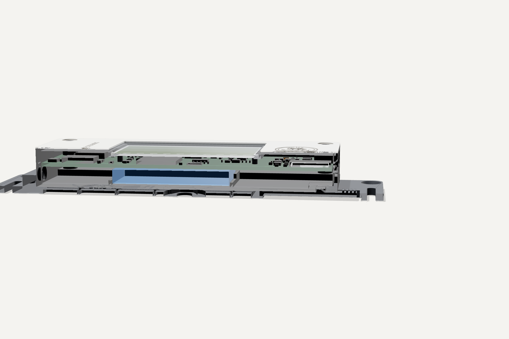

# Case, keycaps and mount

OpenSCAD, fully parametric, and driven by the board: outline, holes, connectors, keys, display,
LEDs and sensors are read from `hardware/kicad/logger.kicad_pcb`, so a board change is one command.

```
python3 case/tools/build.py --extract   # read the board, then STLs, mass and renders
python3 case/tools/build.py --no-render # STLs and mass only
```

Needs OpenSCAD 2021.01 or newer, the Inter font, and for renders node with Playwright
(`npm install` once in `case/tools/render`).

| Renders | |
|---|---|
|  |  |
|  |  |
|  |  |

Built from the routed 138 x 62 mm board (commit 094aea5). The extractor also reads the display
outline, active area and flex from Dwgs.User, and adds the hotswap sockets on the back.

## Files

| File | What |
|---|---|
| `case.scad` | All parts and the assembly. `-D part="front"` etc. exports one part in print orientation. |
| `params.scad` | Everything you might want to change: fits, walls, the cell size, barometer mode, mount. |
| `board.scad` | Generated by `tools/extract_board.py`. Never edit. |
| `art/logo.scad` | The brand emblem re-traced for FDM (strokes >= 0.45 mm), from `tools/mklogo_scad.py`. |
| `stl/` | Print-ready STLs, already oriented. |
| `renders/` | Assembled, exploded, back, right side and "released from the plate". |

## Parts, material and colour

Everything that flies is **PETG**. A cockpit under a canopy in summer passes 60 to 70 °C; PLA
softens from about 55 °C, so PLA is only for test fits. (ASA would be even better if you have it.)
One colour change per part at most; the change is always at a layer height:

| Part | Print | Material | Colour change |
|---|---|---|---|
| `front` | face down, no supports | PETG | first 0.6 mm in natural/white PETG, then graphite. The debossed logo, text, IMU axes and vent show graphite; the LEDs glow through the natural skin. |
| `keybridge` | plate side down | PETG | none (accent colour). It is also the Choc switch plate (13.8 mm, 1.2 mm thick). |
| `cap_up`, `cap_ok`, `cap_dn` | face down | PETG | first 0.6 mm natural, then accent: the debossed mark shows accent. |
| `tray` | bottom down, no supports (dovetail flanks are 30° overhangs) | PETG | none |
| `plate` | bottom down | PETG | none |
| `lcd_frame` | lip side down | PETG | none. The display carrier: boxes the panel on three sides (the key bridge is the fourth), carries it on a lip, stands on posts. |

Size: 142.7 x 66.7 x 17.1 mm, 20.1 mm on its plate (with the default 6 mm cell; a 4 mm cell saves 2 mm).
Mass (PETG, `tools/mass.py`): about 44 g for the unit's plastic, about 39 g for the plate.

## Hardware

Brass inserts and A4 stainless or titanium screws: the magnetometer is on the board.

- 3 x M3 x 4 brass heat-set inserts in the tray columns (corners)
- 3 x M3 x 12 countersunk (ISO 10642), A4 or titanium, through the front into the corner inserts
- 1 x M3 PA66 (nylon) thread-forming screw for the corner next to the radio antenna (H1): no metal near the antenna
- 1 x clear polycarbonate cover, 1.0 mm, laser cut (size printed by OpenSCAD as `cover`), glued into the face pocket
- foam ring for the barometer hood: closed-cell, 1.0 mm thick (squeezed to 0.7 mm), cut to the recess (5.7 x 5.7 mm outside, 2.9 x 2.9 mm inside)
- foam: 0.5 mm closed-cell gasket between glass and face (compressed to 0.3 mm); 1 mm VHB foam pad under the cell
- Qwiic and camera leads to the outside: cut out the 0.6 mm knock-out next to each socket in the top wall
- optional: ePTFE vent sticker (6 mm) over the bottom-wall barometer outlet; for the static port instead: a 4 mm OD push-in hose barb (nylon)
- mount: 4 x M4 countersunk (or the AMPS pattern, or one 1/4"-20 nut), 25 mm webbing / hook-and-loop strap

## Humidity sensor and microphone

- The SHT40 and the top-port microphone sit together at the left board edge. Two slots in the left wall open
  right in front of them, and baffles on both sides of the board (stopping 0.4 mm short of it) make a small
  chamber, so they read and hear cockpit air, not the warm case. No board cut-out, no holes on top.
- The barometer sits under a hood sealed onto the board with a foam ring (the board keeps a 1.8 mm free ring
  round the sensor for it), with a 1.4 mm duct out through the bottom wall next to the keys.
- `case-section-ducts` shows the chamber and the barometer hood from above.
- Battery: the cell lead plugs into J2 from the right, turns down a gully in the right wall of both shells and
  runs under the board to the cell; a bridge clip in the tray holds it (`case-section-battery`).
- `case-section-mic` shows both.

## How it holds the IMU still

The board is clamped at its four corner holes between the front bosses and full-height columns in the
tray, so the case itself is the reference. The unit then slides onto the plate on two dovetails
(30° flanks, 0.25 mm fit) until it hits the stop, and a snap hook on a spring arm in the plate
drops into a notch in the tray: two dovetails fix roll, pitch, yaw and two axes, the stop and the
hook fix the third. Same position every time, no wobble, no tools. To release, push the ribbed
tab at the right end down and slide the unit off to the right. The hook face is square, so
vibration and g cannot walk it out; only the tab releases it.

Mounting options from the plate: strap slots at both ends (25 mm webbing, e.g. round a tube or a
thigh), 4 countersunk M4 holes, the AMPS 30 x 38 pattern used by RAM and most cockpit mounts, and
a captive 1/4"-20 nut for camera-style ball mounts. Screw or strap the plate once; the unit comes
off for charging and the SD card stays reachable on the right edge in either case.

## Barometer

One sealed hood serves both modes; the print is the same. The outlet in the bottom wall (next to the keys)
has a 4.2 mm counterbore:

- cockpit air (default): leave it open, an ePTFE vent sticker over it keeps dust out.
- static port: press a 4 mm hose barb into the outlet and connect the aircraft's static line. This needs
  approval before it is used on an aircraft.

`baro_mode` in `params.scad` only records which one a unit is built for.

## Things to check on the first print

- Choc cap stem fit (`choc_peg`): PETG shrinks differently per printer; print one cap first.
- Dovetail fit (`fit`) and the snap: should slide by hand with no play once the hook is in.
- Bridge feet and display posts are placed automatically on free spots of the board (nearest to their
  ideal place); the build prints where they went and echoes `CHECK:` for any clearance problem.
- The display carrier's lip is 0.2 mm above the tallest part under it (J63, 2.9 mm), on eight posts.
- Display under load (panel under 9 g, checked at 15 g x 1.5 = 22.5 g, about 2 N): towards the board the
  panel bears on the lip and eight posts (36 mm2, about 0.06 MPa); towards the face it bears on the face round
  the window through the 0.3 mm gasket (about 0.1 MPa); sideways the carrier walls hold it and six lugs on the
  face hold the carrier (about 0.3 MPa wall bending). PETG takes about 50 MPa, layer bonds about 25 MPa.
  The flex never carries the panel. Rattle is what matters in flight: use a gasket that is compressed when
  closed (0.5 mm foam in the 0.3 mm gap).

<details><summary>Easter eggs (spoilers)</summary>

- The charge LED shines through a unicorn horn.
- The IMU's origin and axes are marked on the case where the sensor sits (when the display does not cover it).
- Inside the face and on the tray floor: PER PERFECTIONEM AD FELICITATEM.
- Under the unit, on the plate: "YOU FOUND IT. NOW FLY IT." and the emblem.
- The battery bay labels the cell it was built for.
- The OK key carries a star.
</details>

## GNSS: patch and SMA

The board carries an 18 mm ceramic patch (AE1) under the face, left of the display, and an edge-mount SMA jack (J50) on the left end for an external antenna.

- **Over the patch:** plastic only. There is 1.1 mm of air between the patch and the face. The nearest screw or insert is about 19 mm away, and the build checks that none comes within 10 mm. The Cassiopeia inlay over it is first-colour PETG.
- **SMA:** the jack's square flange sits in a square pocket. The pocket is split between the front shell and the tray, and a 1 mm boss on the wall puts 1.6 mm of PETG behind the flange, so cable torque and pull go into the case and not into the solder joints. About 6 mm of thread stays outside for the antenna plug, and the jack sits above the mount plate's stop block.
- **Dust cap:** `sma_cap` is printed in PETG. Its three crush ribs grip the thread crests, and a lanyard eye lets you tie it to the mount. An off-the-shelf tethered SMA dust cap works too.
