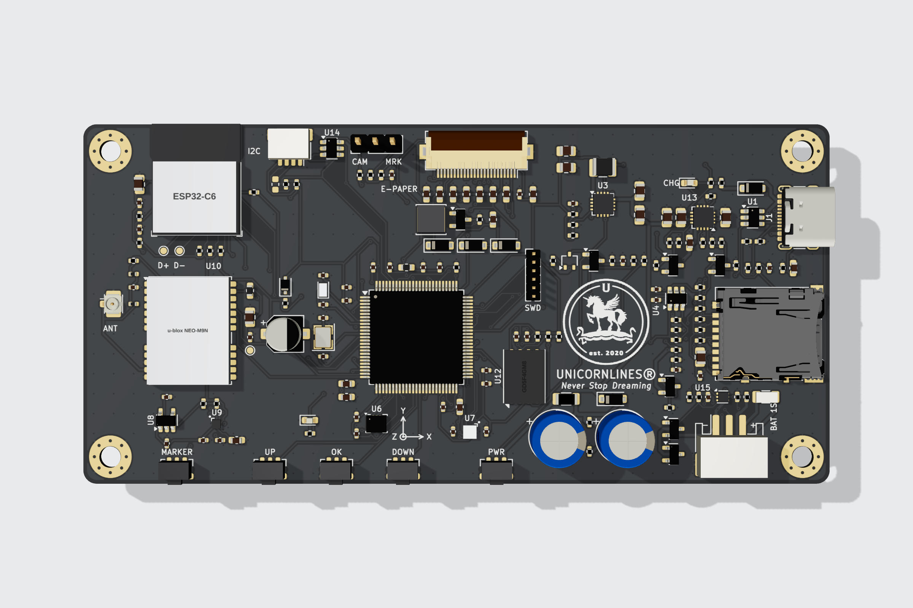

# Hardware

Rev A draft schematic and board for the logger, in KiCad 7 format. Both are generated from code:

- `tools/design.py`: every part and every pin's net. **Edit this, not the `.kicad_sch` files.**
- `tools/mklib.py`: builds `kicad/logger.kicad_sym` for parts KiCad doesn't ship (ICM-45686, BMP390, BMM350, NEO-M9N, ESP32-C6-MINI-1, GD5F4GM8UE), with pin tables from the datasheets.
- `tools/gen.py`: writes the sheets under `kicad/`, joining nets with global labels and flagging unused pins.
- `tools/check.py`: connectivity checks on the exported netlist (every assigned pin is on its net, power nets are driven, no output conflicts). It stands in for ERC, which the KiCad 7 command line doesn't have.

```sh
cd hardware/tools
python3 mklib.py && python3 gen.py
kicad-cli sch export netlist ../kicad/logger.kicad_sch -o /tmp/logger.net
python3 check.py /tmp/logger.net
kicad-cli sch export pdf ../kicad/logger.kicad_sch -o ../kicad/logger.pdf
```

`kicad/logger.pdf` is the latest export, for review without KiCad.

## Board


- 112 x 54 mm (about 2:1), 4 layers, 1.6 mm: F.Cu signals and GND pour, In1 solid GND, In2 +3V3 pour with a few signal runs, B.Cu signals and GND pour.
- Rules: 0.15 mm track and clearance, 0.5/0.25 mm vias, 0.4 mm for the power path.
- Floor plan, left to right: radio (top-left corner) and GNSS on the left; the MCU with its crystals, log flash and sensors in the middle; power on the right (3.3 V buck, charger, USB protection, power latch, hold-up supercaps, battery socket with its protection). Passives sit in straight rows and columns next to the pins they serve.
- Edges: USB-C and microSD flush on the right short edge (the card goes in through the case wall). All five buttons are Alps SKRT side-push switches on the bottom long edge, actuators at the board edge: MARKER at the left end, UP / OK / DOWN in the middle, PWR at the right end (recessed in the case). The top edge carries the radio antenna, the Qwiic and camera/marker sockets (cables out of the top) and the e-paper FPC. The battery socket sits in the bottom-right corner.
- The IMU moved from the Bosch BMI563 (still not on sale) to the TDK ICM-45686 on 2026-11-25.
- The magnetometer sits at the left end, as far as possible from the buck, the supercaps and the battery currents; the barometer sits under the MCU's SPI2 corner and needs the case's hose chamber over it.
- Storage: flights are logged to the soldered 512 MB GigaDevice GD5F4GM8UE flash next to the MCU (about 4.5 hours of raw logging; stocked at JLCPCB); the microSD keeps a backup copy and serves firmware updates and export.
- GNSS antenna feed: hand-routed 0.25 mm on F.Cu from the U.FL to the module, short and direct over the In1 ground.
- Radio: ESP32-C6-MINI-1 in the top-left corner, flush with the top edge. Its antenna sits over a cut-out in the board, as Espressif's guidelines ask, so there is no board material under it. The case wall in front of it must be plastic. It may stay on in flight (fine from an avionics point of view); bulk Wi-Fi transfers happen on the ground. Planned uses: camera start/stop over Bluetooth, wireless firmware updates for both chips, compressed flight download.
- Silkscreen: references only for ICs, connectors with function labels instead (MARKER, UP, OK, DOWN, PWR, CHG, BAT 1S +/−, SWD, CAM, MRK, I2C, ANT, microSD, E-PAPER, D+/D-), IMU axes next to U6. Passive references are on F.Fab for assembly.
- Top: the Unicornlines logo with "UNICORNLINES®" and "Never Stop Dreaming". Back: "AEROBATICS LOGGER", the revision, and *PER PERFECTIONEM AD FELICITATEM*.
- The logo is `art/unicornlines-logo.svg`, turned into the `logger:Unicornlines_Logo` silkscreen footprint by `tools/mklogo.py` (strokes thickened to the 0.16 mm silk minimum). Re-run it only when the artwork changes: `python3 mklogo.py ../art/unicornlines-logo.svg Unicornlines_Logo 13.0`.
- M3 holes at the corners, 4 mm in, grounded.

Rebuild (needs KiCad 7 Python and a Freerouting 2.x jar):

```sh
cd hardware/tools
python3 pcb.py && python3 route.py /path/to/freerouting.jar
```

`pcb.py` builds the placed, unrouted board from `design.py` plus its placement table, and `route.py` routes, pours and runs DRC. The committed board is DRC-clean (0 errors, 0 unconnected). The only warnings are the "library not in this configuration" notes from a headless KiCad without the global footprint table.

Renders: `tools/render/` turns the board into a GLB (KiCad STEP export, then OCCT), plots the layers into board textures and renders the views with three.js in headless Chromium. Parts KiCad has no 3D model for here (NEO-M9N, ESP32-C6 module, TPS62130, BQ24074, BQ29700, side-push switches, battery fuse, BMP390, BMM350, flash, inductors, JST sockets, 32 kHz crystal) are drawn as plain boxes.

| Top | Bottom |
| --- | --- |
|  |  |

## Sheets

| Sheet | Contents |
| --- | --- |
| Power | USB-C sink (CC level read by the ADC to set the input current), TVS and USB ESD, TI BQ24074 1S Li-ion linear charger with power path (charge current and input limit set by resistors: 0.25 A / 0.44 A by hardware, 1.0 A / 1.39 A switched in by the MCU; 0-50 °C window from the NTC in the battery pack; safety timer), soft power latch on the buck's EN (PWR button, MCU hold line, USB power), charge LED, on-board cell protection (TI BQ29700 with two low-side AO3400A FETs) and a 3 A fuse, 3-pin JST-PH battery socket (1 cell −, 2 NTC, 3 cell +) with reverse-polarity PMOS, battery voltage to the ADC, 0.5 F hold-up (2 x 1 F in series), TPS62130 buck to 3.3 V, VDDA filter, MCP65R41 power-fail comparator |
| MCU | STM32H723VGT6, decoupling, 25 MHz and 32.768 kHz crystals, RTC/GNSS backup supercap, SWD header, status LED |
| Sensors | TDK ICM-45686 IMU (SPI1, ±32 g, ±4000 °/s), BMP390 barometer (SPI2), BMM350 magnetometer (I2C1) with its 1.8 V LDO |
| GNSS | NEO-M9N (25 Hz, JLCPCB stock), active antenna feed (u-blox VCC_RF bias circuit), U.FL. VDD_USB grounded (USB unused). A NEO-F9P drops in with the same wiring |
| IO | GD5F4GM8UEYIG 4 Gbit (512 MB) log flash on OCTOSPI1 (quad): the main flight log. microSD (SDMMC1) as backup copy, firmware update and export path, GDEY0213B74 2.13-inch e-paper with its booster, five side-push buttons (UP, OK, DOWN, on-unit MARKER in parallel with the external one, PWR on the power sheet), camera-sync and marker-button header (J62: sync out, GND, marker in), Qwiic I2C expansion socket (J63, I2C4, PTC-fused 3V3) for an optional airspeed sensor |
| Radio | ESP32-C6-MINI-1 (Wi-Fi 6, BLE 5) as an SPI4 slave sharing SCK/MOSI with the e-paper, IRQ line, EN and boot straps driven by the MCU, UART0 to the MCU for flashing, USB D-/D+ test pads |

## Open items

- [x] ICM-45686: pin table checked against DS-000577 section 4.1 (via a page-referenced extraction of the datasheet): RESV pins 2, 3, 7, 10, 11 may be NC, VDDIO or GND, so they stay open with their internal pull-ups on; 0.1 uF X7R on VDD and on VDDIO as specified; VDD 1.71 to 3.6 V and VDDIO 1.08 to 3.6 V cover 3.3 V. Axis arrows (pin 1 top-left, +X right, +Y up, +Z out of the top) match TDK's convention and CogniPilot's footprint silk for this part. Firmware: turn off the internal pull-ups on the four active SPI pins.
- [x] BMP390 pin table (DS002 table 52) and BMM350 ball table (DS001 section 6, top view) match the symbols. BMM350: BYPASS to GND, CRST 2.2 uF to GND, ADSEL low = 0x14, VDD 1.72 to 1.98 V (AP2112K-1.8 gives 1.77 to 1.83 V). Ball map matches four independent footprints.
- [x] E-paper booster: GDEY0213B74 pin table (section 5) matches; pin 8 is BS1, tied low for 4-wire SPI; 6/7 (TSCL/TSDA) and 19 (VPP, test) left open. The reference circuit in section 12 is an image, so values were taken from four open designs that reproduce Good Display's reference: changed to 47 uH (FNR4020S470MT, was 10 uH in 0805), a 30 V AO3400A (the Si2302 is only 20 V against a ~20 V VGH) and 1 uF 50 V on the gate/source rails (was 25 V). 2.2 ohm sense and MBR0530 diodes kept.
- [x] GNSS: NEO-M9N pin table from data sheet UBX-19014285 section 3 (same as SparkFun's symbol). Antenna feed per u-blox's VCC_RF bias circuit (NEO-F9P integration manual 4.4.4.3): 10 ohm, BLM15HB121SH1 ferrite, 100 nF, 47 nH LQG15HS47NJ02 (was 27 nH and 10 nF; 47 nH keeps >500 ohm down to L5 for the F9P). NEO-F9P drop-in checked pin by pin against three independent symbols and its integration manual: same VCC, V_BCKP, UART1, RESET_N, SAFEBOOT_N, TIMEPULSE, RF and GND pins; D_SEL open keeps UART; V_USB (pin 7) grounded as u-blox requires when USB is unused.
- [x] Custom footprints (`logger:` library): WLCSP-9 for the BMM350 drawn from the datasheet. The ICM-45686 uses KiCad's LGA-14 3x2.5 mm.
- [x] BMP390 land pattern fixed: the placeholder had the wrong pad arrangement. Now 2-3-2-3 pads at 0.5 mm pitch, counter-clockwise from pin 1 at top-right, 0.25 x 0.275 mm, matching four independent footprints made from Bosch's data.
- [ ] Rev A layout review: the autorouter's copper is DRC-clean but not hand-polished. Worth a pass in KiCad on the SPI/SDMMC runs around the MCU and the crystal traces.
- [x] ESP32-C6-MINI-1 checked against datasheet v1.5 and the hardware design guidelines: pins match; IO9 10k pull-up (SPI boot), IO8 10k pull-up (needed for download), IO15 10k pull-up (no internal pull, must not float). Added a 499 ohm on U0TXD and 1k between the MCU and EN (EN keeps its 10k pull-down, so the radio is off until the MCU enables it). Board cut-out under the antenna as the guidelines ask; the module stays flush with the top edge. Firmware: RADIO_BOOT high before EN rises and for 3 ms after.
- [x] GD5F4GM8UE checked: pin-out as the family table (DS-01328 section 2.2, same order as Winbond W25N); WSON8 8x6 drawing from its own datasheet (DS-00846 rev 1.3, fig. 20-1: D 8.00, E 6.00, D2 3.40, E2 4.30, b 0.40, L 0.50, e 1.27 nom). KiCad's WSON-8 8x6 EP 3.4x4.3 (made from GigaDevice's drawing) covers the terminals at max and min tolerance. EP tied to GND. OCTOSPI1 pins checked against ST's pin data: PB2 (36) P1_CLK, PE11 (41) P1_NCS, PD11 (58) P1_IO0, PD12 (59) P1_IO1, PE2 (1) P1_IO2, PD13 (60) P1_IO3. Firmware: wait tVSL = 2 ms after power-up; 2 KB pages, 64 pages per block, 4096 blocks with at least 4016 good; on-chip ECC on by default.
- [x] Battery charger (changed 2026-11-26 to support small and large cells): TI BQ24074RGT (RGT0016B), checked against SLUS810N: pin table 7-1 (1 TS, 2/3 BAT, 4 /CE, 5 EN2, 6 EN1, 7 /PGOOD, 8 VSS, 9 /CHG, 10/11 OUT, 12 ILIM, 13 IN, 14 TMR, 15 ITERM, 16 ISET, pad = VSS) matches KiCad's BQ24074RGT symbol. ICHG = KISET / RISET with KISET 797/890/975 A·Ω: 3.57k gives 0.25 A (0.22-0.27 A), so any cell from 250 mAh charges at 1C or less before firmware runs; Q5 adds 1.18k in parallel for 1.0 A (0.90-1.10 A), switched on only for a cell of 1000 mAh or more as entered in setup. Input limit (EN2 high, EN1 low = ILIM mode, table 7-2): IIN = KILIM / RILIM, 3.48k gives 0.38-0.49 A (inside USB's 500 mA), Q6 adds 1.74k for 1.39 A (1.29-1.48 A) on a 1.5 A or 3 A source. Timer: RTMR 71.5k gives 57 min pre-charge and 9.5 h fast charge (KTMR 48 s/kΩ typ). ITERM open: 10 % termination. TS: the pack's 10k NTC (103AT type) straight to TS gives TI's 0-50 °C window; no NTC means no charging. The charge LED is fed from VBUS so it can never drain the cell. Thermal: up to about 1.3 W in the charger at 1 A (θJA 44.5 °C/W), so it sits on a solid ground pour with vias and TI's thermal regulation throttles it in a hot cockpit. The exposed-pad size is only in TI's package drawing, which could not be read here; KiCad's VQFN-16 3x3 EP 1.68 mm land (the same one the TPS62130 uses) is within 0.1 mm of every TI RGT variant, but the pad should be checked against the RGT0016B drawing before ordering.
- [x] Power latch (added 2026-11-26): the TPS62130's EN is driven by a BAT54C (PWR button from VSYS, MCU hold line PD4) and a BAT54W from VBUS through 100k, with 1M and 1 µF to ground: plugging in USB or pressing PWR turns the logger on, firmware holds it on, and EN stays up for about 2 s across a firmware reset. PD7 reads the button through 100k / 470k (3.6 V at VSYS 4.4 V, 2.5 V at 3.0 V).
- [ ] Side-push switches: Alps SKRTLAE010 (JLCPCB C110293, 4.5 x 3.4 x 3.3 mm, 1.6 N, 0.2 mm travel, -40 to +90 °C, guide bosses; specs from Alps' product page and the LCSC listing). Alps' land dimensions are only published as an image (and a members-only drawing) that could not be read here, so the land pattern is KiCad's library footprint, with the two outer terminal pads narrowed by 0.1 mm on the boss-hole side so copper stays 0.17 mm from the NPTH bosses (KiCad's original leaves under 0.1 mm). Check against Alps' drawing before ordering. The switch is not sealed: the case's button caps carry the seal.
- [x] Cell protection (added 2026-11-25): TI BQ29700 checked against SLUSBU9I rev I: pin table 5-1 (DSE: 1 NC, 2 COUT, 3 DOUT, 4 VSS, 5 BAT, 6 V−) matches KiCad's BQ297xy symbol; thresholds from the device comparison table (OVP 4.275 V / 1.25 s, UVP 2.800 V / 144 ms, OCC −100 mV / 8 ms, OCD 100 mV / 20 ms, SCD 0.5 V / 250 µs; 0 V charging inhibited below 0.75 V); application values from fig. 9-1 (330 Ω and 100 nF on BAT, 2.2 kΩ on V−, 5.1 MΩ gate pull-downs). KiCad's WSON-6 1.5 x 1.5 land pattern (0.5 mm pitch, longer pin-1 pad) matches the DSE0006A example board layout. FETs: two AO3400A (already on the board), about 50-60 mΩ in series, so the over-current trips sit at roughly 1.7-2 A at room temperature, above the logger's load (under 0.7 A) and the firmware charge current (1 A maximum). Fuse: Littelfuse 0466003.NR, 3 A very fast, 1206, as the last layer behind the charger and the protector. The pack carries a 10k NTC on pin 2; a pack without one is never charged. The hold-up Schottky D2 is now a B5819W (SOD-123, 1 A 40 V) to free board space.
- [x] ESD: SRV05-4 on J62 (camera sync, marker) and J63 (I2C expansion and its fused 3.3 V), for IEC 61000-4-2 / DO-160 section 25.
- [ ] Run full ERC in KiCad 8 or later on a desktop.
