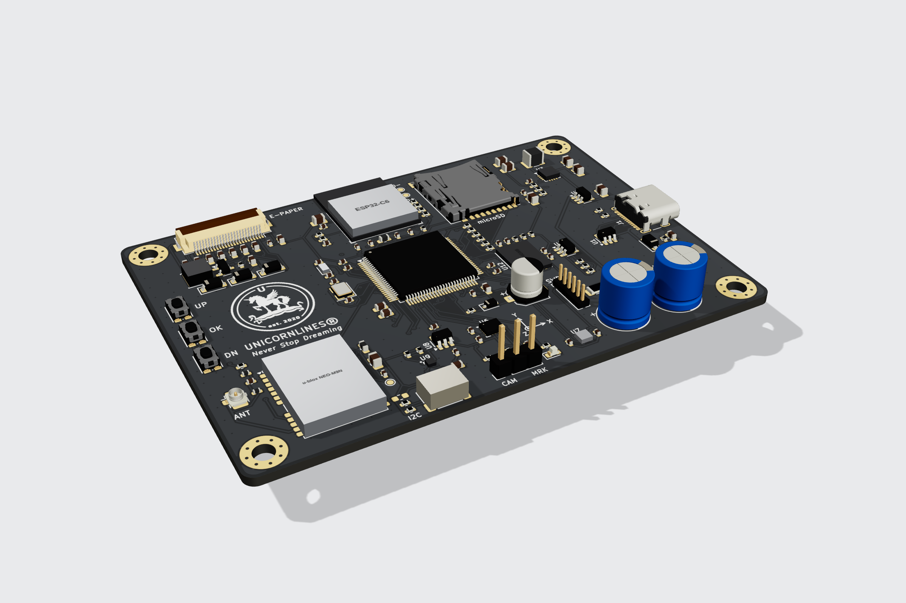

# Hardware

Rev A draft schematic and board for the logger, in KiCad 7 format. Both are generated from code:

- `tools/design.py`: every part and every pin's net. **Edit this, not the `.kicad_sch` files.**
- `tools/mklib.py`: builds `kicad/logger.kicad_sym` for parts KiCad doesn't ship (ICM-45686, BMP390, BMM350, NEO-M9N, ESP32-C6-MINI-1, GD5F4GM8UE), with pin tables from the datasheets.
- `tools/gen.py`: writes the sheets under `kicad/`, joining nets with global labels and flagging unused pins.
- `tools/check.py`: connectivity checks on the exported netlist (every assigned pin is on its net, power nets are driven, no output conflicts). It stands in for ERC, which the KiCad 7 command line doesn't have.

```sh
cd hardware/tools
python3 mklib.py && python3 gen.py
kicad-cli sch export netlist ../kicad/logger.kicad_sch -o /tmp/logger.net
python3 check.py /tmp/logger.net
kicad-cli sch export pdf ../kicad/logger.kicad_sch -o ../kicad/logger.pdf
```

`kicad/logger.pdf` is the latest export, for review without KiCad.

## Board



- 88 x 62 mm, 4 layers, 1.6 mm: F.Cu signals and GND pour, In1 solid GND, In2 +3V3 pour with a few signal runs, B.Cu signals and GND pour.
- Rules: 0.15 mm track and clearance, 0.5/0.25 mm vias, 0.3 mm for the power path.
- Blocks follow the block diagram: power enters on the right (USB-C) and flows left; MCU in the centre; display FPC top left with the buttons below it; GNSS bottom left; sensors below the MCU; hold-up supercaps bottom right; microSD top edge.
- The IMU moved from the Bosch BMI563 (still not on sale) to the TDK ICM-45686 on 2026-11-25.
- The magnetometer sits away from the buck and the supercaps; the barometer is at the bottom edge under the hose chamber.
- Storage: flights are logged to the soldered 512 MB GigaDevice GD5F4GM8UE flash next to the MCU (about 4.5 hours of raw logging; stocked at JLCPCB); the microSD keeps a backup copy and serves firmware updates and export.
- GNSS antenna feed: hand-routed 0.25 mm on F.Cu from the U.FL to the module, short and direct over the In1 ground.
- Radio: ESP32-C6-MINI-1 flush with the top edge. Its antenna sits over a cut-out in the board, as Espressif's guidelines ask, so there is no board material under it. The case wall in front of it must be plastic. It may stay on in flight (fine from an avionics point of view); bulk Wi-Fi transfers happen on the ground. Planned uses: camera start/stop over Bluetooth, wireless firmware updates for both chips, compressed flight download.
- Silkscreen: references only for ICs, connectors with function labels instead (UP/OK/DN, SWD, CAM, ANT, microSD, E-PAPER, D-/D+), IMU axes next to U6. Passive references are on F.Fab for assembly.
- Top: the Unicornlines logo with "UNICORNLINES®" and "Never Stop Dreaming". Back: "AEROBATICS LOGGER", the revision, and *PER PERFECTIONEM AD FELICITATEM*.
- The logo is `art/unicornlines-logo.svg`, turned into the `logger:Unicornlines_Logo` silkscreen footprint by `tools/mklogo.py` (strokes thickened to the 0.16 mm silk minimum). Re-run it only when the artwork changes: `python3 mklogo.py ../art/unicornlines-logo.svg Unicornlines_Logo 13.0`.
- M3 holes at the corners, 4 mm in, grounded.

Rebuild (needs KiCad 7 Python and a Freerouting 2.x jar):

```sh
cd hardware/tools
python3 pcb.py && python3 route.py /path/to/freerouting.jar
```

`pcb.py` builds the placed, unrouted board from `design.py` plus its placement table, and `route.py` routes, pours and runs DRC. The committed board is DRC-clean (0 errors, 0 unconnected). The only warnings are the "library not in this configuration" notes from a headless KiCad without the global footprint table.

Renders: `tools/render/` turns the board into a GLB (KiCad STEP export, then OCCT), plots the layers into board textures and renders the views with three.js in headless Chromium. Parts KiCad has no 3D model for (NEO-F10N, ESP32-C6 module, TPS62130, BMP390, BMM350, 32 kHz crystal) are drawn as plain boxes.

| Top | Bottom |
| --- | --- |
|  |  |

## Sheets

| Sheet | Contents |
| --- | --- |
| Power | USB-C sink, TVS and USB ESD, MAX40200 ideal diode, 0.5 F hold-up (2 x 1 F in series), TPS62130 buck to 3.3 V, VDDA filter, MCP65R41 power-fail comparator |
| MCU | STM32H723VGT6, decoupling, 25 MHz and 32.768 kHz crystals, RTC/GNSS backup supercap, SWD header, status LED |
| Sensors | TDK ICM-45686 IMU (SPI1, ±32 g, ±4000 °/s), BMP390 barometer (SPI2), BMM350 magnetometer (I2C1) with its 1.8 V LDO |
| GNSS | NEO-M9N (25 Hz, JLCPCB stock), active antenna feed (u-blox VCC_RF bias circuit), U.FL. VDD_USB grounded (USB unused). A NEO-F9P drops in with the same wiring |
| IO | GD5F4GM8UEYIG 4 Gbit (512 MB) log flash on OCTOSPI1 (quad): the main flight log. microSD (SDMMC1) as backup copy, firmware update and export path, GDEY0213B74 2.13-inch e-paper with its booster, 3 buttons, camera-sync and marker-button header (J62: sync out, GND, marker in), Qwiic I2C expansion socket (J63, I2C4, PTC-fused 3V3) for an optional airspeed sensor |
| Radio | ESP32-C6-MINI-1 (Wi-Fi 6, BLE 5) as an SPI4 slave sharing SCK/MOSI with the e-paper, IRQ line, EN and boot straps driven by the MCU, UART0 to the MCU for flashing, USB D-/D+ test pads |

## Open items

- [x] ICM-45686: pin table checked against DS-000577 section 4.1 (via a page-referenced extraction of the datasheet): RESV pins 2, 3, 7, 10, 11 may be NC, VDDIO or GND, so they stay open with their internal pull-ups on; 0.1 uF X7R on VDD and on VDDIO as specified; VDD 1.71 to 3.6 V and VDDIO 1.08 to 3.6 V cover 3.3 V. Axis arrows (pin 1 top-left, +X right, +Y up, +Z out of the top) match TDK's convention and CogniPilot's footprint silk for this part. Firmware: turn off the internal pull-ups on the four active SPI pins.
- [x] BMP390 pin table (DS002 table 52) and BMM350 ball table (DS001 section 6, top view) match the symbols. BMM350: BYPASS to GND, CRST 2.2 uF to GND, ADSEL low = 0x14, VDD 1.72 to 1.98 V (AP2112K-1.8 gives 1.77 to 1.83 V). Ball map matches four independent footprints.
- [x] E-paper booster: GDEY0213B74 pin table (section 5) matches; pin 8 is BS1, tied low for 4-wire SPI; 6/7 (TSCL/TSDA) and 19 (VPP, test) left open. The reference circuit in section 12 is an image, so values were taken from four open designs that reproduce Good Display's reference: changed to 47 uH (FNR4020S470MT, was 10 uH in 0805), a 30 V AO3400A (the Si2302 is only 20 V against a ~20 V VGH) and 1 uF 50 V on the gate/source rails (was 25 V). 2.2 ohm sense and MBR0530 diodes kept.
- [x] GNSS: NEO-M9N pin table from data sheet UBX-19014285 section 3 (same as SparkFun's symbol). Antenna feed per u-blox's VCC_RF bias circuit (NEO-F9P integration manual 4.4.4.3): 10 ohm, BLM15HB121SH1 ferrite, 100 nF, 47 nH LQG15HS47NJ02 (was 27 nH and 10 nF; 47 nH keeps >500 ohm down to L5 for the F9P). NEO-F9P drop-in checked pin by pin against three independent symbols and its integration manual: same VCC, V_BCKP, UART1, RESET_N, SAFEBOOT_N, TIMEPULSE, RF and GND pins; D_SEL open keeps UART; V_USB (pin 7) grounded as u-blox requires when USB is unused.
- [x] Custom footprints (`logger:` library): WLCSP-9 for the BMM350 drawn from the datasheet. The ICM-45686 uses KiCad's LGA-14 3x2.5 mm.
- [x] BMP390 land pattern fixed: the placeholder had the wrong pad arrangement. Now 2-3-2-3 pads at 0.5 mm pitch, counter-clockwise from pin 1 at top-right, 0.25 x 0.275 mm, matching four independent footprints made from Bosch's data.
- [ ] Rev A layout review: the autorouter's copper is DRC-clean but not hand-polished. Worth a pass in KiCad on the SPI/SDMMC runs around the MCU and the crystal traces.
- [x] ESP32-C6-MINI-1 checked against datasheet v1.5 and the hardware design guidelines: pins match; IO9 10k pull-up (SPI boot), IO8 10k pull-up (needed for download), IO15 10k pull-up (no internal pull, must not float). Added a 499 ohm on U0TXD and 1k between the MCU and EN (EN keeps its 10k pull-down, so the radio is off until the MCU enables it). Board cut-out under the antenna as the guidelines ask; the module stays flush with the top edge. Firmware: RADIO_BOOT high before EN rises and for 3 ms after.
- [x] GD5F4GM8UE checked: pin-out as the family table (DS-01328 section 2.2, same order as Winbond W25N); WSON8 8x6 drawing from its own datasheet (DS-00846 rev 1.3, fig. 20-1: D 8.00, E 6.00, D2 3.40, E2 4.30, b 0.40, L 0.50, e 1.27 nom). KiCad's WSON-8 8x6 EP 3.4x4.3 (made from GigaDevice's drawing) covers the terminals at max and min tolerance. EP tied to GND. OCTOSPI1 pins checked against ST's pin data: PB2 (36) P1_CLK, PE11 (41) P1_NCS, PD11 (58) P1_IO0, PD12 (59) P1_IO1, PE2 (1) P1_IO2, PD13 (60) P1_IO3. Firmware: wait tVSL = 2 ms after power-up; 2 KB pages, 64 pages per block, 4096 blocks with at least 4016 good; on-chip ECC on by default.
- [ ] Run full ERC in KiCad 8 or later on a desktop.
