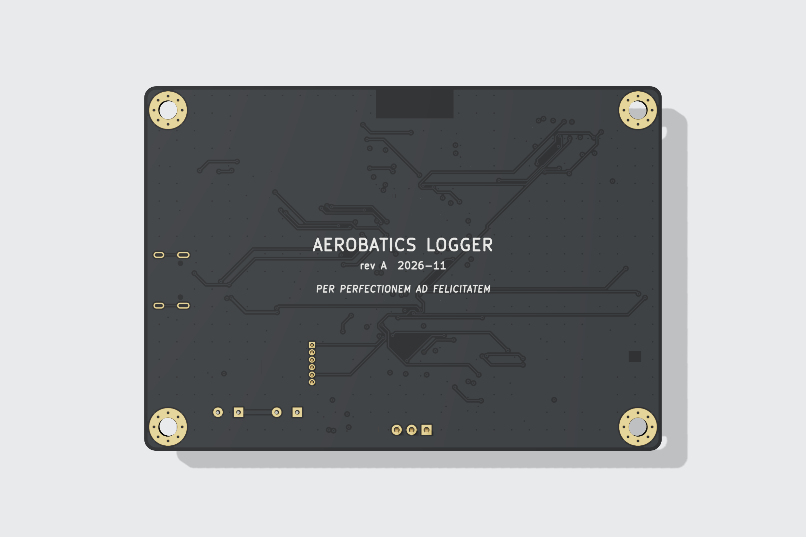

# Hardware

Rev A draft schematic and board for the logger, in KiCad 7 format. Both are generated from code:

- `tools/design.py`: every part and every pin's net. **Edit this, not the `.kicad_sch` files.**
- `tools/mklib.py`: builds `kicad/logger.kicad_sym` for parts KiCad doesn't ship (BMI563, BMP390, BMM350, NEO-F10N, ESP32-C6-MINI-1), with pin tables from the datasheets.
- `tools/gen.py`: writes the sheets under `kicad/`, joining nets with global labels and flagging unused pins.
- `tools/check.py`: connectivity checks on the exported netlist (every assigned pin is on its net, power nets are driven, no output conflicts). It stands in for ERC, which the KiCad 7 command line doesn't have.

```sh
cd hardware/tools
python3 mklib.py && python3 gen.py
kicad-cli sch export netlist ../kicad/logger.kicad_sch -o /tmp/logger.net
python3 check.py /tmp/logger.net
kicad-cli sch export pdf ../kicad/logger.kicad_sch -o ../kicad/logger.pdf
```

`kicad/logger.pdf` is the latest export, for review without KiCad.

## Board


- 88 x 62 mm, 4 layers, 1.6 mm: F.Cu signals and GND pour, In1 solid GND, In2 +3V3 pour with a few signal runs, B.Cu signals and GND pour.
- Rules: 0.15 mm track and clearance, 0.5/0.25 mm vias, 0.3 mm for the power path.
- Blocks follow the block diagram: power enters on the right (USB-C) and flows left; MCU in the centre; display FPC top left with the buttons below it; GNSS bottom left; sensors below the MCU; hold-up supercaps bottom right; microSD top edge.
- The magnetometer sits away from the buck and the supercaps; the barometer is at the bottom edge under the hose chamber.
- Radio: ESP32-C6-MINI-1 flush with the top edge. Its antenna sits over a copper-free area on all four layers, one of the two placements Espressif allows (the other overhangs the edge, for slightly better range). The case wall in front of it must be plastic. It may stay on in flight (fine from an avionics point of view); bulk Wi-Fi transfers happen on the ground. Planned uses: camera start/stop over Bluetooth, wireless firmware updates for both chips, compressed flight download.
- Silkscreen: references only for ICs, connectors with function labels instead (UP/OK/DN, SWD, CAM, ANT, microSD, E-PAPER, D-/D+), IMU axes next to U6. Passive references are on F.Fab for assembly.
- Top: the Unicornlines logo with "UNICORNLINES®" and "Never Stop Dreaming". Back: "AEROBATICS LOGGER", the revision, and *PER PERFECTIONEM AD FELICITATEM*.
- The logo is `art/unicornlines-logo.svg`, turned into the `logger:Unicornlines_Logo` silkscreen footprint by `tools/mklogo.py` (strokes thickened to the 0.16 mm silk minimum). Re-run it only when the artwork changes: `python3 mklogo.py ../art/unicornlines-logo.svg Unicornlines_Logo 13.0`.
- M3 holes at the corners, 4 mm in, grounded.

Rebuild (needs KiCad 7 Python and a Freerouting 2.x jar):

```sh
cd hardware/tools
python3 pcb.py && python3 route.py /path/to/freerouting.jar
```

`pcb.py` builds the placed, unrouted board from `design.py` plus its placement table, and `route.py` routes, pours and runs DRC. The committed board is DRC-clean (0 errors, 0 unconnected). The only warnings are the "library not in this configuration" notes from a headless KiCad without the global footprint table.

Renders: `tools/render/` turns the board into a GLB (KiCad STEP export, then OCCT), plots the layers into board textures and renders the views with three.js in headless Chromium. Parts KiCad has no 3D model for (NEO-F10N, ESP32-C6 module, TPS62130, BMP390, BMM350, 32 kHz crystal) are drawn as plain boxes.

| Top | Bottom |
| --- | --- |
|  |  |

## Sheets

| Sheet | Contents |
| --- | --- |
| Power | USB-C sink, TVS and USB ESD, MAX40200 ideal diode, 0.5 F hold-up (2 x 1 F in series), TPS62130 buck to 3.3 V, VDDA filter, MCP65R41 power-fail comparator |
| MCU | STM32H723VGT6, decoupling, 25 MHz and 32.768 kHz crystals, RTC/GNSS backup supercap, SWD header, status LED |
| Sensors | BMI563 IMU (SPI1), BMP390 barometer (SPI2), BMM350 magnetometer (I2C1) with its 1.8 V LDO |
| GNSS | NEO-F10N, active antenna feed, SMA |
| IO | microSD (SDMMC1), GDEY0213B74 2.13-inch e-paper with its booster, 3 buttons, camera-sync header |
| Radio | ESP32-C6-MINI-1 (Wi-Fi 6, BLE 5) as an SPI4 slave sharing SCK/MOSI with the e-paper, IRQ line, EN and boot straps driven by the MCU, UART0 to the MCU for flashing, USB D-/D+ test pads |

## Open items

- [ ] BMI563 pinout is from Bosch's preliminary flyer; confirm against the full datasheet when released.
- [ ] Add the ICM-45686 alternate footprint once its pin table is checked (DS-000577, section 4.1).
- [ ] BMP390 and BMM350 pin tables: check against the datasheet figures.
- [ ] E-paper booster values (MOSFET, 10 uH, 2.2 ohm sense, MBR0530 diodes, 1 uF caps): check against the GDEY0213B74 reference circuit, datasheet section 12.
- [ ] NEO-F10N: confirm the active-antenna feed against the integration manual, and pin compatibility with NEO-F9P.
- [x] Custom footprints (`logger:` library): WLCSP-9 for the BMM350 drawn from the datasheet. The BMI563 uses KiCad's Bosch LGA-14.
- [ ] BMP390 land pattern `logger:Bosch_LGA-10_2.0x2.0mm` is a placeholder: check against the datasheet's recommended footprint before ordering.
- [ ] Rev A layout review: the autorouter's copper is DRC-clean but not hand-polished. Worth a pass in KiCad on the SPI/SDMMC runs around the MCU and the crystal traces.
- [ ] ESP32-C6-MINI-1: footprint is Espressif's; check the strapping (IO8 pull-up, IO9 driven by the MCU, IO15 pull-up) and the antenna keepout against the hardware design guidelines.
- [ ] Run full ERC in KiCad 8 or later on a desktop.
